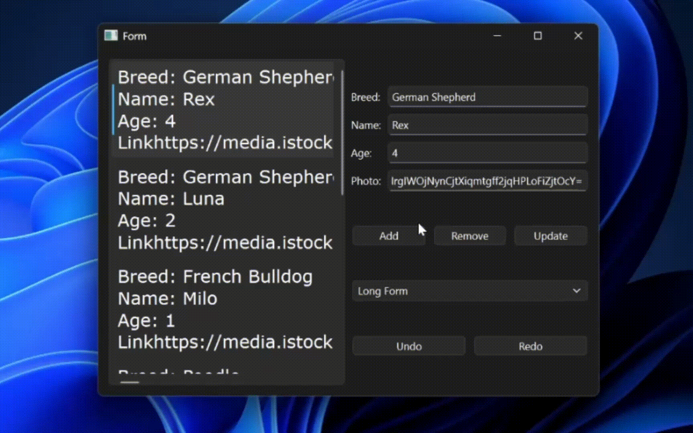
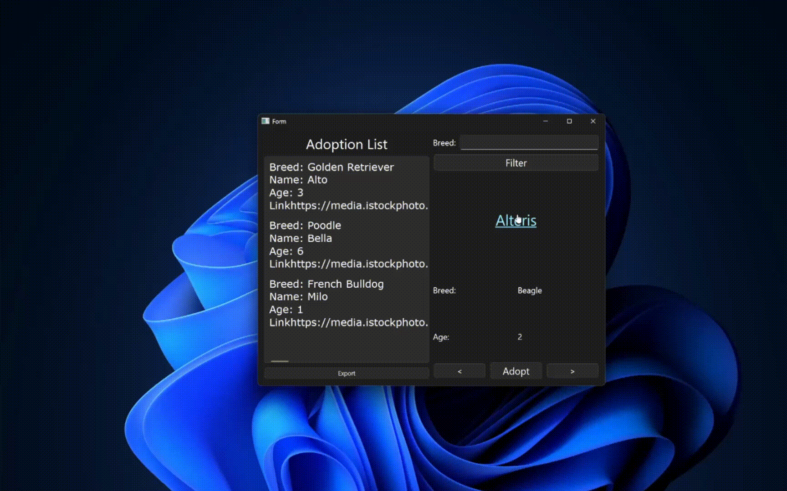

# Pet Shop

Pet Shop is a C++ desktop application built with Qt Widgets that simulates the adoption workflow of an animal shelter. It has two separate interfaces: an Admin panel for managing the dog database, and a Client panel where users can browse, filter, and adopt dogs.

This project was developed as part of an OOP course during my 2nd semester of studying Computer Science at UBB Cluj, as a way of both learning and applying fundamental software engineering principles and modern C++ practices.

## What it does

The app runs in one of two modes, chosen at startup:

- **Admin mode** lets you add, remove, and update dog records, with full undo/redo support.
- **Client mode** lets you browse the available dogs, filter them by breed, and adopt one — adoptions get saved out to a CSV or HTML file.

You also choose the storage backend at startup: a SQLite database (through the sqlite_orm library) or a plain text file, both implementing the same repository interface so the rest of the app doesn't care which one is active.

## Design and architecture

The project is split into clear layers: domain, repository, service, and UI, so the business logic never talks directly to Qt or to a specific storage format. A few patterns came up naturally while building it:

- **Command pattern** for undo/redo: every add/remove/update is wrapped in an `Action` object that knows how to reverse itself, and `UndoService` keeps two stacks to move back and forth through history.
- **Repository pattern** to abstract data access: `BaseRepository` is an interface implemented by both `SqlRepository` and `TextFileRepository`, so `AdminService` and `UserService` work against the interface, not a concrete database.
- A small hierarchy of custom exceptions (`RepositoryException`, `ServiceException`, `ValidatorException`, `UndoException`, `AdoptionException`) is used instead of error codes or silent failures.

## Tech stack

- C++17
- Qt Widgets for the GUI (signals & slots, `.ui` Designer forms)
- SQLite as the embedded database, accessed through the sqlite_orm header-only ORM
- Standard library containers and file streams for the text-based storage option
- Built with Microsoft Visual Studio (MSVC, `.vcxproj`)

## What I Learned

### Software Architecture & Design
- **Layered architecture**: separating domain, repository, service, and UI code
- **Design Patterns**: Command pattern for undo/redo, Repository pattern for data access abstraction

### C++ Concepts
- **OOP Fundamentals**: inheritance, polymorphism, encapsulation, abstraction
- **Exception Handling**: custom exception hierarchy across layers
- **Other C++ Features**: smart pointers (`std::unique_ptr`), operator overloading, file streams for I/O

### Database Integration
- **SQLite with C++**: integrating a relational database into a C++ application
- **ORM usage**: mapping objects to tables with sqlite_orm instead of raw SQL
- **CRUD Operations**: add, remove, and update records through a repository interface

### GUI Development
- **Qt Widgets**
- **Qt Designer**: building UI layouts with the designer tool and wiring them up with signals & slots

## Demos
### Admin mode

### User mode

